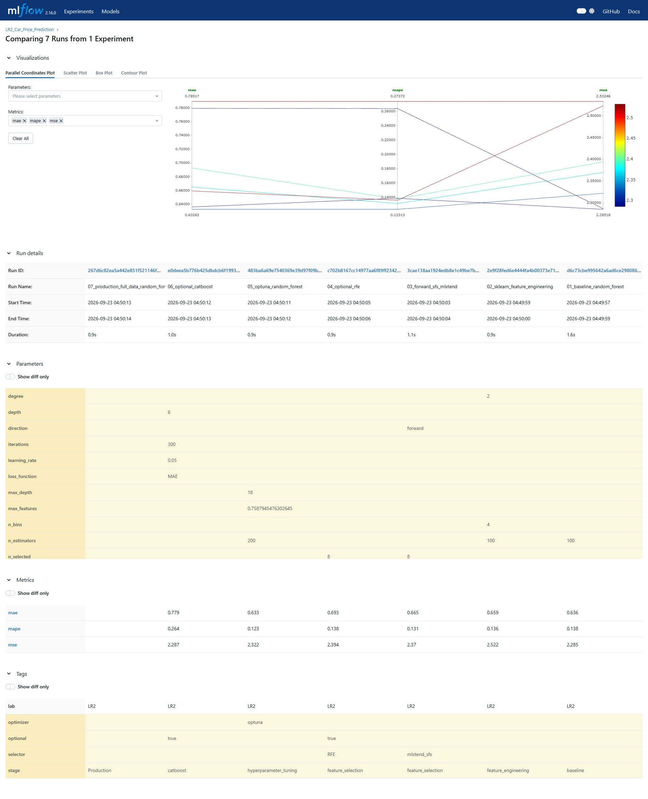
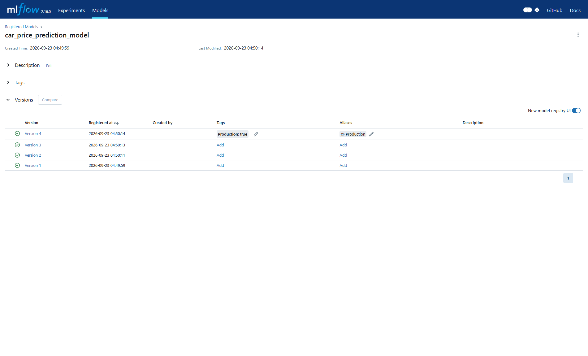

# Лабораторная работа №2. Car Price Prediction

## Описание проекта

Прогнозирование цены подержанного автомобиля (`Selling_Price`), задача регрессии.
Репозиторий содержит EDA из ЛР1 и эксперименты ЛР2: RandomForest baseline,
генерацию и отбор признаков, настройку Optuna, сравнение моделей и MLflow.
Дополнительно выполнены RFE и CatBoost.

Датасет: [Car Price Prediction — Used Cars](https://www.kaggle.com/datasets/vijayaadithyanvg/car-price-predictionused-cars/data).
В исходных данных 301 строка и 9 столбцов. После удаления 2 дубликатов,
2 объектов `CNG`, 10 объектов `Owner=1` и 1 объекта `Owner=3` осталось
286 строк. После добавления `Car_Age` используются 9 входных признаков
и целевая переменная. Разбиение train/test — 214/72 (75%/25%), seed=42.
Исключение малочисленных категорий ограничивает применимость модели к этим группам.

## Описание модулей проекта

```text
lab2-car-price/
├── data/README.md                   # Источник данных и инструкция по загрузке
├── eda/
│   ├── eda.ipynb                    # ЛР1: очистка, EDA, сохранение clean_data.pkl
│   ├── graph1_...png ... graph6_...png
│   └── graph7_interactive.html
├── research/
│   ├── research.ipynb               # ЛР2: выполненный notebook
│   ├── experiment_results.md        # Сравнение метрик
│   ├── feature_names_sklearn.txt
│   ├── selected_feature_names.txt
│   ├── selected_feature_indices.txt
│   ├── rfe_feature_names.txt
│   ├── rfe_feature_indices.txt
│   ├── production_columns.txt
│   ├── production_run_id.txt
│   ├── experiment_id.txt
│   ├── MLmodel                      # Описание Production-модели
│   ├── model_runs.png               # Сравнение runs и метрик в MLflow
│   ├── model_versions.png           # Зарегистрированные версии и Production
│   └── environment_validation.json  # Сохранённый результат проверки модели
├── mlflow/start_mlflow.sh            # MLflow 2.16, SQLite, локальные artifacts
├── requirements.txt
├── .gitignore
├── .gitattributes
└── README.md
```

Файлы данных `*.csv`, `*.pkl`, виртуальное окружение, база MLflow и модельные
artifacts не включены в Git. История MLflow сохраняется отдельной резервной копией.

## Запуск

Окружение: Ubuntu 22.04, Python 3.10, VS Code с расширениями Python и Jupyter.

```bash
git clone https://github.com/Webber-Escaper/lab2-car-price.git
cd lab2-car-price
python3 -m venv .venv_lab1
source .venv_lab1/bin/activate
python -m pip install --upgrade pip
python -m pip install -r requirements.txt
python -m pip check
```

Имя `.venv_lab1` сохранено в скрипте запуска. Окружение создаётся внутри этого
репозитория и используется и для EDA, и для ЛР2.

1. Скачать датасет по ссылке выше. Переименовать `car data.csv` в `car_data.csv`
   и поместить в `data/` (подробнее в [data/README.md](data/README.md)).
2. Открыть `eda/eda.ipynb`, выбрать `.venv_lab1/bin/python` и выполнить все ячейки.
   Notebook создаст `data/clean_data.pkl` и графики.
3. В терминале из корня проекта запустить MLflow:

```bash
source .venv_lab1/bin/activate
cd mlflow
sh start_mlflow.sh
```

Скрипт создаёт SQLite `mlflow/mlruns.db` и хранит artifacts в `mlflow/mlartifacts/`.
Оставить терминал работающим. Открыть http://127.0.0.1:5000/ в браузере Ubuntu.

4. В VS Code открыть `research/research.ipynb`, выбрать то же окружение и выполнить
   ячейки по порядку. Повторный запуск создаёт новые runs и версии моделей.
5. Сохранить новые скриншоты MLflow в `research/model_runs.png` и
   `research/model_versions.png`. Notebook обновляет метрики, `MLmodel`, run_id
   и автоматически выделенный блок README.

При чистом клонировании старая история MLflow отсутствует. Для её восстановления
нужна отдельная копия базы и artifacts; одного `research/MLmodel` недостаточно
для загрузки весов модели.

## Результаты и выводы EDA (ЛР1)

- Пропусков не обнаружено; удалены дубликаты и указанные малочисленные подгруппы.
- `Selling_Price` имеет правую асимметрию; `Present_Price` сильно положительно
  связан с ценой продажи, `Car_Age` — отрицательно.
- В очищенной выборке дизельные автомобили и автомобили с автоматической коробкой
  имеют более высокие типичные цены. Это описание данной выборки.
- Медианная цена у `Dealer` выше, чем у `Individual`; причинный вывод не делается.
- После очистки `Owner` постоянен. В корреляционную матрицу он не включён;
  `Year` и `Car_Age` одновременно там не используются.
- Сохранены 6 статических графиков и интерактивный Bokeh HTML.

## Эксперименты ЛР2

1. Baseline: StandardScaler для числовых столбцов, OrdinalEncoder для категориальных,
   RandomForestRegressor со 100 деревьями.
2. Feature engineering: PolynomialFeatures (`degree=2`) и KBinsDiscretizer
   (`n_bins=4`, `strategy="quantile"`) для трёх числовых столбцов.
3. Forward SFS: 8 признаков, mlxtend, двухфолдовая CV, negative MAE.
4. RFE: дополнительное сравнение отбора признаков и Jaccard similarity.
5. Optuna: 10 trials, трёхфолдовая CV на train, минимизация MAE;
   `n_estimators=100..400` с шагом 50, `max_depth=3..18`, `max_features=0.1..1.0`.
6. CatBoost: дополнительная модель (`iterations=300`, `depth=6`, `learning_rate=0.05`).
7. Лучший вариант переобучается на всех данных и регистрируется с тегом Production.

## Сохранённые результаты исследования

Результаты ниже соответствуют сохранённому запуску 23.09.2026, notebook,
скриншотам и Production run_id в этом репозитории.

|                             |      mae |     mape |      mse |
|:----------------------------|---------:|---------:|---------:|
| optuna_random_forest        | 0.632630 | 0.123129 | 2.321851 |
| baseline_random_forest      | 0.636031 | 0.138466 | 2.285179 |
| sklearn_feature_engineering | 0.659286 | 0.135843 | 2.522464 |
| forward_sfs                 | 0.664955 | 0.131208 | 2.369676 |
| optional_rfe                | 0.692535 | 0.137637 | 2.393862 |
| optional_catboost           | 0.779166 | 0.263721 | 2.286548 |

<!-- LR2_AUTO_START -->
### Результаты исследования

Лучший результат на тестовой выборке показал **optuna_random_forest**.

- MAE: **0.632630**
- MAPE: **0.123129**
- MSE: **2.321851**
- параметры: `{"n_estimators": 200, "max_depth": 18, "max_features": 0.7587945476302645}`
- Production model version: **4**
- `run_id = 267d6c82ea5a442e851f521146fb51c2`

Используемые исходные столбцы: `Car_Name, Year, Present_Price, Driven_kms, Fuel_Type, Selling_type, Transmission, Owner, Car_Age`.
<!-- LR2_AUTO_END -->

Optuna выбрала baseline-преобразования. Все 7 сохранённых runs завершены;
зарегистрированы 4 версии, версия 4 имеет тег `Production=true` и alias `Production`.
Сигнатура, пример входа, requirements и список столбцов сохранены с моделью.

Baseline имеет немного меньший MSE; выбор Optuna сделан по основной метрике MAE.
Тестовая выборка участвовала в сравнении вариантов, поэтому приведённые метрики
не являются независимой оценкой после выбора модели. Production обучена на всех
286 строках и отдельно на независимых данных не оценивалась.




## Сохранение MLflow для ЛР3

После остановки сервера сохранить весь каталог `mlflow/` вне Git-репозитория:
`start_mlflow.sh`, `mlruns.db` и `mlartifacts/` должны переноситься вместе.
При восстановлении поместить содержимое резервной копии в `mlflow/` этого проекта.
Для следующей работы понадобится Production-модель и её run_id.
